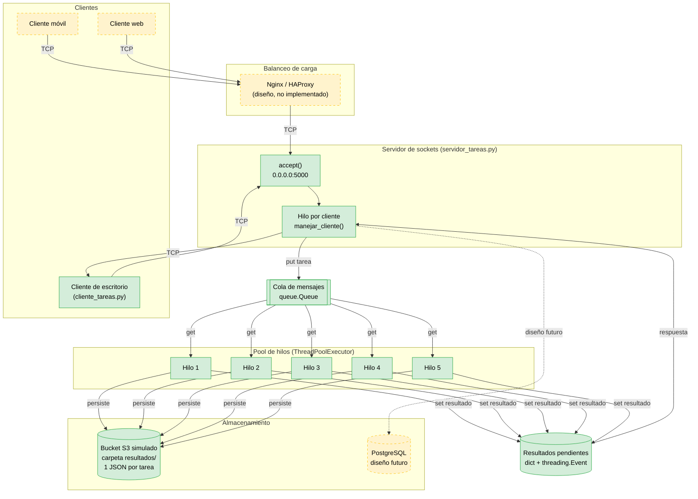

# PFO 3 — Rediseño como Sistema Distribuido (Cliente-Servidor)

Práctica Formativa Obligatoria 3 de la cátedra **Programación sobre Redes**.

Transformación de un sistema en una arquitectura distribuida usando **sockets TCP**,
con una **cola de mensajes**, un **pool de hilos** y **almacenamiento tipo objeto**.

---

## Integrantes

- Luis Barnabó

**Materia:** Programación sobre Redes
**Año:** 2026

---

## Arquitectura

El sistema sigue el patrón **productor-consumidor**:

1. El **cliente** se conecta por TCP y envía una tarea en formato JSON.
2. El **servidor** acepta la conexión, lee la tarea y la encola en una cola de mensajes.
3. Un **pool de hilos (workers)** consume las tareas de la cola y las procesa en paralelo.
4. Cada resultado se **persiste** en un almacenamiento tipo S3 (carpeta local).
5. El servidor devuelve el resultado al cliente por el mismo socket.

### Diagrama

### Leyenda

- **Verde**: componente implementado en el código.
- **Amarillo punteado**: componente incluido en el diseño arquitectónico

### Correspondencia con la consigna

| Ítem de la consigna | En el diagrama | Estado |
|---|---|---|
| Clientes (móviles, web) | `Clientes` | Representados (el cliente de escritorio es el implementado) |
| Balanceador de carga (Nginx/HAProxy) | `LB` | Diseño |
| Servidores workers con pool de hilos | `Pool de hilos` | Implementado |
| Cola de mensajes (RabbitMQ) | `queue.Queue` | Implementado (equivalente en memoria) |
| Almacenamiento distribuido (PostgreSQL, S3) | `S3` y `DB` | S3 simulado con carpeta local; PostgreSQL diseño futuro |